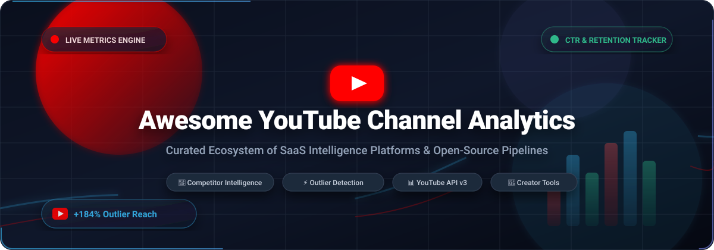

# 🚀 Awesome YouTube Channel Analytics

<p align="center">
  <a href="https://github.com/ishandutta2007/Awesome-Awesome-Awesome"></a>
  <a href="https://discord.gg/jc4xtF58Ve"></a>
  <a href="https://github.com/ishandutta2007/Awesome-Youtube-Channel-Analytics/stargazers"></a>
  <a href="https://github.com/ishandutta2007/Awesome-Youtube-Channel-Analytics/network/members"></a>
  <a href="https://github.com/ishandutta2007/Awesome-Youtube-Channel-Analytics/blob/main/LICENSE"></a>
  <a href="https://github.com/ishandutta2007/Awesome-Youtube-Channel-Analytics/pulls"></a>
  <a href="https://github.com/ishandutta2007"></a>
</p>

<p align="center">
  <a href="https://github.com/ishandutta2007/Awesome-Youtube-Channel-Analytics">
    
  </a>
</p>

---

### 📌 Curated Directory of SaaS Intelligence Platforms & Open-Source Data Pipelines

> **Master the YouTube Algorithm:** A curated collection of top-tier **SaaS intelligence suites** and **open-source developer tools** engineered for **YouTube Channel Analytics**, competitor benchmarking, outlier video discovery, audience retention tracking, thumbnail A/B analysis, and revenue optimization.

`#YouTubeAnalytics` `#CreatorIntelligence` `#ChannelAnalytics` `#YouTubeDataAPI` `#OutlierDetection` `#CreatorEconomy` `#VideoSEO` `#SocialMediaAnalytics`

---

## 📑 Table of Contents

- [📈 Sector Overview & Market Dynamics](#-sector-overview--market-dynamics)
- [🏢 SaaS / Hosted Intelligence Platforms](#-saas--hosted-intelligence-platforms)
- [🛠️ Open-Source GitHub Projects](#️-open-source-github-projects)
- [💡 Key YouTube Analytics Metrics & Strategies](#-key-youtube-analytics-metrics--strategies)
- [🏗️ Recommended Architectural Blueprints](#️-recommended-architectural-blueprints)
- [🤝 How to Contribute](#-how-to-contribute)
- [⭐ Star History](#-star-history)
- [☕ Support & Sponsorship](#-support--sponsorship)
- [📜 Disclaimer & License](#-disclaimer--license)

---

## 📈 Sector Overview & Market Dynamics

The global social video analytics and creator intelligence market is estimated at **$4.8B – $5.6B in 2026** (projected to reach **$12.5B+ by 2030** at an annual CAGR of ~21.4%), driven by the rapid growth of the broader $250B+ creator economy and the shift toward algorithm-first, performance-benchmarked video advertising.

### 🌐 Market Structure & Competition
- **Moderately Fragmented (Two-Tier Structure):** Rather than a pure "winner-take-all" monopoly, the market is divided into two distinct operating segments:
  1. **Enterprise & Omnichannel Suites** (*Sprout Social, Hootsuite, Tubular Labs*) catering to Fortune 500 brands, global media networks, and PR agencies requiring cross-platform governance, compliance, and multi-network attribution.
  2. **YouTube-Native Creator Suites** (*vidIQ, TubeBuddy, ViewStats*) capturing creator-operators, production studios, and MCNs focused on algorithmic packaging, CTR maximization, and outlier video pattern recognition.
- **Rise of Self-Hosted & AI Agentic Pipelines:** With platform API quota constraints and escalating SaaS subscription fees, developers and high-volume media houses increasingly leverage open-source pipelines (combining `yt-dlp`, DuckDB/SQLite, LLM agent toolkits, and Streamlit/Grafana) to build proprietary, privacy-preserving channel intelligence infrastructure.

---

## 🏢 SaaS / Hosted Intelligence Platforms

The following table benchmarks category-leading SaaS platforms for YouTube analytics, competitor tracking, and audience intelligence. Products are **sorted descending by estimated company size / market valuation**.

| 🏢 Platform | 📊 Company Size / Valuation | 🎯 Core Capabilities & YouTube Focus | 💰 Pricing (Starting Tier) | 🆓 Free Tier Limits / Free Trial |
| :--- | :--- | :--- | :--- | :--- |
| **[Sprout Social](https://sproutsocial.com/)** | **~$1.8B Market Cap** *(NASDAQ: SPT, ~$385M ARR)* | Enterprise-grade social listening, YouTube channel performance reporting, competitor benchmarking, message tagging, and unified asset workflow. | **$249 / seat / mo** *(Standard Plan; $199/mo billed annually)* | **30-Day Free Trial:** Full access to Standard features for up to 5 social profiles including YouTube; no credit card required. |
| **[Hootsuite](https://www.hootsuite.com/)** | **~$1.0B+ Valuation** *(~$250M ARR)* | Multi-channel social video management, YouTube video publishing & scheduling, audience sentiment tracking, and customized team ROI dashboards. | **$99 / mo** *(Professional Plan, billed annually)* | **30-Day Free Trial:** Full access for 1 user and up to 10 social profiles, automated scheduling, and performance analytics. |
| **[NoxInfluencer](https://www.noxinfluencer.com/)** | **~$200M+ Valuation** *(Parent Nox Digital, ~$40M ARR)* | 100M+ creator database, global YouTube channel rankings, influencer CPM/RPM valuation, brand sponsorship tracking, and audience demographic insights. | **$499 / mo** *(Business Plan, $1,499 billed quarterly or $3,899/yr)* | **Free Forever Tools:** 5 public creator searches per day, standalone YouTube Money Calculator, and top channel category leaderboards. |
| **[TubeBuddy](https://www.tubebuddy.com/)** | **~$200M+ Valuation** *(Acquired by BENlabs, ~$100M+ parent ARR)* | Browser extension & web studio featuring YouTube video A/B title/thumbnail testing, Search Rank tracking, bulk metadata find-and-replace, and SEO Studio. | **$12.00 / mo** *(Pro Plan; $4.50/mo for channels &lt;1K subs with `RisingStarBuddy` code)* | **Free Forever Plan:** 1 connected channel, limited Keyword Explorer (top 3 search results only), basic video health checks, and thumbnail generator. |
| **[Tubular Labs](https://tubularlabs.com/)** | **~$100M+ Valuation** *(Acquired by Chartbeat, $50M+ raised, ~$35M ARR)* | Enterprise video intelligence measuring 11B+ videos across YouTube, TikTok, and Instagram; category audience overlap, cross-platform de-duplicated reach, and media buy benchmarking. | **$1,500 / mo** *(Plus Plan entry contract; approx. $18,000 billed annually)* | **14-Day Guided Trial:** Granted upon enterprise sales demo qualification; limited to 100 benchmark queries and curated sector views. |
| **[HypeAuditor](https://hypeauditor.com/)** | **~$100M Valuation** *(Raised $10M+, ~$25M ARR)* | AI-powered fraud detection, audience authenticity scoring, YouTube sponsor mentions tracker, competitor ad-spend analysis, and influencer recruitment CRM. | **$299 / mo** *(Basic Plan, billed annually at $3,588/yr)* | **Free Forever Account:** 1 media plan, 40+ free calculators (subscriber quality, engagement rate, fake follower audit), top 3 search results preview. |
| **[vidIQ](https://vidiq.com/)** | **~$80M – $100M Valuation** *(Battery Ventures-backed, ~$30M ARR)* | Daily AI video topic ideas, YouTube keyword volume scorecards, live competitor tracking, real-time views-per-hour (VPH) velocity alerts, and channel audit checklist. | **$39.00 / mo** *(Boost Plan; discounted to $16.58/mo on annual billing at $199/yr)* | **Free Forever Plan:** 150 AI credits/month, competitor monitoring for up to 3 channels, standard browser extension overlay with basic video scorecard. |
| **[ViewStats](https://www.viewstats.com/)** | **~$35M – $50M Valuation** *(Founded by MrBeast & Beast Industries)* | Outlier video discovery engine, algorithmic outlier multiplier calculation, thumbnail visual search, A/B packaging inspection, and niche creator collections. | **$49.99 / mo** *(Pro Plan; discounted to $39.99/mo on annual billing at $479.88/yr)* | **Free Forever Plan:** Basic channel profile searches, 7-day historical views/subscribers charts, ViewStats Chrome extension, and general video search. |
| **[Metricool](https://metricool.com/)** | **~$35M – $50M Valuation** *(Axon Partners-backed, ~€12M ARR)* | Unified social media management, automated YouTube video & Shorts scheduling, visual performance dashboards, competitor analysis, and Looker Studio connector. | **$20.00 / mo** *(Starter Plan for up to 5 brands; $16/mo billed annually)* | **Free Forever Plan:** 1 brand profile, 1 connected YouTube channel, up to 20 scheduled posts/month, 30 days of analytics history, 5 fixed competitors. |
| **[Social Blade](https://socialblade.com/)** | **~$15M – $25M Valuation** *(Bootstrapped, ~$6M ARR)* | Historical subscriber/view tracking, Social Blade SB Rank grades, estimated ad revenue ranges, future growth projections, and multi-platform creator comparison. | **$3.99 / mo** *(Bronze Plan; $3.33/mo on annual billing at $39.99/yr)* | **Free Forever Plan:** Public access to top 100 channels, 5 favorites per platform, and past 30 days historical charts (ad-supported). |
| **[ChannelMeter](https://www.channelmeter.com/)** | **~$10M Valuation** *(Venture-backed, ~$3M ARR)* | Creator management suite for MCNs, agencies, and brands; automated revenue split calculations, campaign tracking, talent CRM, and cross-channel performance analytics. | **$199 / mo** *(Creator Network entry tier via custom onboarding)* | **Free Forever Account:** Public creator & channel search engine, 30-day view velocity trend graphs, and basic channel bookmarking. |
| **[ThoughtMetric](https://www.thoughtmetric.com/)** | **~$5M Valuation** *(Seed / bootstrapped, ~$1M ARR)* | E-commerce and multi-channel marketing attribution tracking YouTube creator ROAS, server-side conversion tracking, first-party cookie data, and pixel-free attribution. | **$99.00 / mo** *(Growth Plan for up to 50,000 monthly tracked pageviews)* | **14-Day Free Trial:** Full access to all attribution models, unlimited user seats, YouTube integration, and revenue tracking up to 50k pageviews. |

---

## 🛠️ Open-Source GitHub Projects

Explore the finest open-source repositories for building self-hosted YouTube analytics stacks, automated reporting bots, and channel intelligence pipelines. Repositories are **sorted descending by GitHub Stars_Count**.

- **[youtube/api-samples](https://github.com/youtube/api-samples)** <a href="https://github.com/youtube/api-samples/stargazers"></a>  
  *Official code samples from the YouTube Developer Relations team.* Comprehensive reference implementations for the **YouTube Data API v3**, **YouTube Analytics API**, and **YouTube Reporting API** across Python, JavaScript, Java, Go, PHP, Ruby, and .NET. Demonstrates OAuth2 channel token handling, asynchronous bulk report scheduling, and targeted channel metrics retrieval.

- **[spacesdrive/twiligent](https://github.com/spacesdrive/twiligent)** <a href="https://github.com/spacesdrive/twiligent/stargazers"></a>  
  *Privacy-first local analytics dashboard.* Connects directly to YouTube and Instagram APIs to render unified channel statistics, follower changes, and engagement metrics on your local machine without subscription lock-ins or third-party cloud data transmission.

- **[migueesc123/YoutubeAnalytics](https://github.com/migueesc123/YoutubeAnalytics)** <a href="https://github.com/migueesc123/YoutubeAnalytics/stargazers"></a>  
  *Custom Microsoft Power Query (M) & Power BI Data Connector.* Interfaces directly with the YouTube Analytics API to stream channel dimensions, geography, playback locations, and operating system statistics straight into Power BI for interactive executive dashboards.

- **[dav19e/VidIQ-Boosted-Insight-Suite](https://github.com/dav19e/VidIQ-Boosted-Insight-Suite)** <a href="https://github.com/dav19e/VidIQ-Boosted-Insight-Suite/stargazers"></a>  
  *AI title generator, channel audit toolkit, and analytics suite.* Implements channel health diagnostics, competitive gap detection, and viral title generation inspired by VidIQ Boost functionality.

- **[adityaarsharma/youtube-marketing-skills](https://github.com/adityaarsharma/youtube-marketing-skills)** <a href="https://github.com/adityaarsharma/youtube-marketing-skills/stargazers"></a>  
  *Agent-agnostic YouTube growth toolkit with 21 AI commands & live channel Model Context Protocol (MCP).* Seamlessly interfaces with Claude Code, Cursor, Codex, and Windsurf to perform competitor gap scans, outlier video scoring, tag SEO generation, and performance audits. Positioned as a free, transparent alternative to vidIQ/TubeBuddy.

- **[DenverCoder1/github-readme-youtube-stats](https://github.com/DenverCoder1/github-readme-youtube-stats)** <a href="https://github.com/DenverCoder1/github-readme-youtube-stats/stargazers"></a>  
  *Dynamic SVG metrics card generator for GitHub READMEs.* Fetches real-time channel statistics (subscribers, total views, video count) via YouTube Data API and outputs customizable, themed SVG visual badges.

- **[parafoxia/analytix](https://github.com/parafoxia/analytix)** <a href="https://github.com/parafoxia/analytix/stargazers"></a>  
  *High-performance Python SDK and client wrapper for the YouTube Analytics API.* Features type hints, automated token refresh, intelligent error handling, query validation, and native data export to Pandas, Polars, Apache Arrow, and Excel.

- **[madEffort/youtube-trend-dashboard](https://github.com/madEffort/youtube-trend-dashboard)** <a href="https://github.com/madEffort/youtube-trend-dashboard/stargazers"></a>  
  *YouTube trend and sentiment analytics dashboard.* Ingests trending video metadata, executes NLP sentiment analysis over viewer comments, and calculates advertiser suitability scores with visual chart breakdowns.

- **[AnMol12499/AWS-Youtube-Analytics](https://github.com/AnMol12499/AWS-Youtube-Analytics)** <a href="https://github.com/AnMol12499/AWS-Youtube-Analytics/stargazers"></a>  
  *End-to-end cloud data lakehouse on AWS.* Utilizes AWS Lambda, AWS Glue, Athena, S3, and QuickSight to clean, partition, and query large-scale structured/semi-structured trending YouTube video datasets.

- **[Prem-ium/youtube-analytics-bot](https://github.com/Prem-ium/youtube-analytics-bot)** <a href="https://github.com/Prem-ium/youtube-analytics-bot/stargazers"></a>  
  *Discord bot for YouTube channel statistics.* Sends automated channel alerts, subscriber milestones, view velocity reports, and estimated ad revenue calculations straight into Discord server channels.

- **[ForrestKnight/youtube-data-first-24](https://github.com/ForrestKnight/youtube-data-first-24)** <a href="https://github.com/ForrestKnight/youtube-data-first-24/stargazers"></a>  
  *First-24-hour performance velocity tracker.* Built specifically for creator studios to benchmark early video traction, hourly velocity curves, and click-through performance against channel 30-day averages.

- **[JensBender/youtube-channel-analytics](https://github.com/JensBender/youtube-channel-analytics)** <a href="https://github.com/JensBender/youtube-channel-analytics/stargazers"></a>  
  *Production ETL pipeline for competitor intelligence.* Orchestrated using Apache Airflow and Docker with AWS S3 storage, performing NLP comment sentiment classification and feeding dynamic Power BI executive dashboards.

- **[MarkEdmondson1234/youtubeAnalyticsR](https://github.com/MarkEdmondson1234/youtubeAnalyticsR)** <a href="https://github.com/MarkEdmondson1234/youtubeAnalyticsR/stargazers"></a>  
  *R client for the YouTube Analytics & Reporting API.* Part of the Google cloud data science ecosystem in R, supporting automated batch report ingestion, authentication, and integration with `ggplot2` and Shiny.

- **[airscholar/YoutubeAnalytics](https://github.com/airscholar/YoutubeAnalytics)** <a href="https://github.com/airscholar/YoutubeAnalytics/stargazers"></a>  
  *Real-time streaming data engineering pipeline.* Streams YouTube channel metrics through Apache Kafka, processes events with ksqlDB, and broadcasts instant subscriber/view milestone notifications via Telegram bots.

- **[zainmz/Youtube-Channel-Analytics-Dashboard](https://github.com/zainmz/Youtube-Channel-Analytics-Dashboard)** <a href="https://github.com/zainmz/Youtube-Channel-Analytics-Dashboard/stargazers"></a>  
  *Predictive analytics dashboard and content strategy tool.* Delivers historical video performance metrics, forecasts view trajectories with regression models, and performs tag network community detection.

- **[binitghetiya/youtube-analytics-api](https://github.com/binitghetiya/youtube-analytics-api)** <a href="https://github.com/binitghetiya/youtube-analytics-api/stargazers"></a>  
  *OAuth2 integration starter kit for YouTube Analytics API.* Minimalist boilerplate for handling token lifecycles, user authentication, and fetching daily channel performance data in Python.

- **[katelynsills/youtubeanalytics](https://github.com/katelynsills/youtubeanalytics)** <a href="https://github.com/katelynsills/youtubeanalytics/stargazers"></a>  
  *Automated MySQL database sync pipeline.* Pulls historical channel and video telemetry from the YouTube Analytics API and preserves structured time-series tables inside a relational SQL database.

- **[StamTheo28/youtube-dashboard](https://github.com/StamTheo28/youtube-dashboard)** <a href="https://github.com/StamTheo28/youtube-dashboard/stargazers"></a>  
  *Django-based YouTube comment intelligence dashboard.* Performs sentiment analysis over thousands of viewer comments, displays interactive frequency distributions, and provides CSV data export.

- **[RunnyEgg/Youtube-Dashboard](https://github.com/RunnyEgg/Youtube-Dashboard)** <a href="https://github.com/RunnyEgg/Youtube-Dashboard/stargazers"></a>  
  *Python channel analytics visualizer.* Utilizes the YouTube Data API v3 and Pandas to analyze lifetime channel statistics, watch time trends, and engagement ratios.

- **[svllvsxprod/Shorts_Tracker](https://github.com/svllvsxprod/Shorts_Tracker)** <a href="https://github.com/svllvsxprod/Shorts_Tracker/stargazers"></a>  
  *FastAPI multi-platform short-form video intelligence.* Tracks YouTube Shorts, TikTok, and Instagram Reels using `yt-dlp` without requiring OAuth keys or official API quotas. Features delta charts, median view calculations, and Telegram alerts.

- **[harsha151/youtube-analytics-dashboard](https://github.com/harsha151/youtube-analytics-dashboard)** <a href="https://github.com/harsha151/youtube-analytics-dashboard/stargazers"></a>  
  *Flask-based YouTube analytics web app.* Features SQL database storage, paginated query results, and timestamp tracking for monitoring video engagement across YouTube channels.

- **[devtayyabsajjad/YouTube-Analytics-Tool](https://github.com/devtayyabsajjad/YouTube-Analytics-Tool)** <a href="https://github.com/devtayyabsajjad/YouTube-Analytics-Tool/stargazers"></a>  
  *Interactive frontend YouTube channel inspector.* Search channels by handle or URL to view subscriber counts, lifetime views, estimated RPM earnings, and Chart.js trend visualizations.

- **[dmmdea/OpenClaw-Youtube-Analyst-Skills](https://github.com/dmmdea/OpenClaw-Youtube-Analyst-Skills)** <a href="https://github.com/dmmdea/OpenClaw-Youtube-Analyst-Skills/stargazers"></a>  
  *Claude Code skills for YouTube analyst pipelines.* Bootstraps Google Cloud, OAuth2, and Google Ads API integrations with 6 MCP servers to evaluate organic-vs-paid outlier scoring and matched-pair thumbnail analyses.

- **[SuNiL-Chau/Youtube-Dashboard](https://github.com/SuNiL-Chau/Youtube-Dashboard)** <a href="https://github.com/SuNiL-Chau/Youtube-Dashboard/stargazers"></a>  
  *Express.js YouTube metrics monitor.* Lightweight web application integrating the YouTube Data API to display channel subscriber gains, total video counts, and view histories.

- **[playersells/open-data](https://github.com/playersells/open-data)** <a href="https://github.com/playersells/open-data/stargazers"></a>  
  *Open-source creator benchmarks under CC BY 4.0.* Aggregated percentiles for YouTube, TikTok, X, and Twitch covering reach benchmarks, subscriber percentiles, and typical video engagement ratios.

---

## 💡 Key YouTube Analytics Metrics & Strategies

When analyzing channel health or building analytics pipelines, prioritize these core algorithmic signals:

1. **⚡ Outlier Multiplier (Views / Median Channel Baseline):**
   Identifies breakthrough topic ideation. A video achieving $3.5\times$ or higher above the channel’s trailing 10-video median signals strong viral interest outside the core subscriber base.
2. **🎯 Impression Click-Through Rate (CTR) vs. Impression Volume:**
   High CTR on low impressions is standard; high CTR ($>8\%$) on $>100,000$ browse impressions proves stellar title/thumbnail packaging.
3. **⏱️ Average Percentage Viewed (APV) & 30-Second Retention:**
   The ultimate measure of viewer satisfaction. Videos maintaining $>70\%$ retention at the 0:30 mark receive sustained recommendation from the YouTube recommendation engine.
4. **🚀 Velocity (VPH - Views Per Hour):**
   Tracks early viral momentum in the first 24 to 48 hours post-upload. Critical for identifying whether a video has entered algorithmic discovery surfaces.
5. **💵 RPM vs. CPM Spread:**
   Revenue Per Mille (what the creator earns after YouTube's $45\%$ revenue cut) vs Cost Per Mille (what advertisers pay). Pinpoints niche monetization profitability.

---

## 🏗️ Recommended Architectural Blueprints

Build your own self-hosted, quota-efficient YouTube analytics pipeline:

```text
┌─────────────────────────┐       ┌──────────────────────────┐       ┌────────────────────────┐
│  YouTube Data &         │       │  Local Data Store        │       │  Visualization &       │
│  Analytics APIs         │──────▶│  DuckDB / SQLite /       │──────▶│  AI Insights           │
│  (OAuth2 + Reporting)   │       │  PostgreSQL Timescale    │       │  Streamlit / Metabase  │
└─────────────────────────┘       └──────────────────────────┘       └────────────────────────┘
             │                                                                   ▲
             ▼                                                                   │
┌─────────────────────────┐       ┌──────────────────────────┐                   │
│  Fallback Scrapers      │──────▶│  NLP Sentiment &         │───────────────────┘
│  (yt-dlp, RSS feeds)    │       │  Outlier Math Engine     │
└─────────────────────────┘       └──────────────────────────┘
```

- **Data Ingestion:** Use `parafoxia/analytix` for official channel metrics; use `yt-dlp` or RSS for competitor scraping without quota depletion.
- **Storage:** Use SQLite or DuckDB for fast local analytical aggregation, or PostgreSQL for multi-user web dashboards.
- **Reporting & AI Analysis:** Expose local analytics to AI agent runtimes via MCP using `adityaarsharma/youtube-marketing-skills`.

---

## 🤝 How to Contribute

Contributions are warmly welcomed! Help expand this ecosystem:

1. 🍴 **Fork the repository** on GitHub.
2. 🌿 **Create a new branch** (`git checkout -b feature/new-analytics-tool`).
3. 📝 **Add your entry** adhering to the existing format (include name, URL, objective summary, and pricing/Stars_Badge).
4. 📬 **Submit a Pull Request** with a concise description of why the tool adds value to creators or engineers.

Please ensure all submissions adhere to the [Awesome-Awesome-Awesome Guidelines](https://github.com/ishandutta2007/Awesome-Awesome-Awesome).

---

## ⭐ Star History

[](https://star-history.dera.page/#ishandutta2007/Awesome-Youtube-Channel-Analytics&type=date&legend=top-left)

---

## ☕ Support & Sponsorship

Thank you so much for exploring and supporting **Awesome YouTube Channel Analytics**! If you find this curated ecosystem valuable for your channel growth, research, or developer projects:

- ⭐ **Star this repository** to improve its visibility for other creators and developers.
- 🍴 **Fork and share** the repo with your creator network, agency teams, and developer communities.
- ☕ **Buy me a coffee & sponsor ongoing maintenance:**

<p align="center">
  <a href="https://github.com/sponsors/ishandutta2007">
    
  </a>
</p>

Your generous sponsorship directly fuels continuous open-source curation, API maintenance, and new tool evaluations!

---

## 📜 Disclaimer & License

- **Disclaimer:** This repository is an independent community-curated research directory and is not officially affiliated with, endorsed by, or sponsored by YouTube, LLC or Google LLC. YouTube and the YouTube logo are registered trademarks of Google LLC.
- **Compliance:** All open-source tools and scrapers must be operated in accordance with the [YouTube Terms of Service](https://www.youtube.com/t/terms) and [Google API Services User Data Policy](https://developers.google.com/terms/api-services-user-data-policy).
- **License:** Distributed under the [MIT License](file:///C:/Users/hp/Documents/Projects/Awesome-Youtube-Channel-Analytics/LICENSE).
